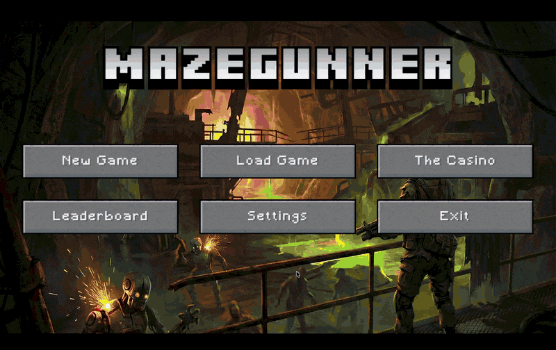
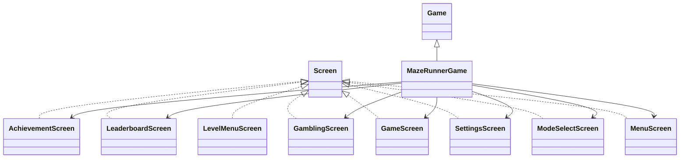
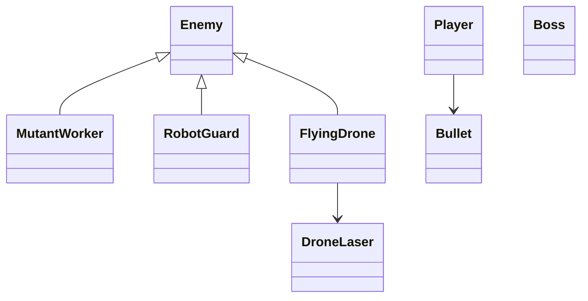
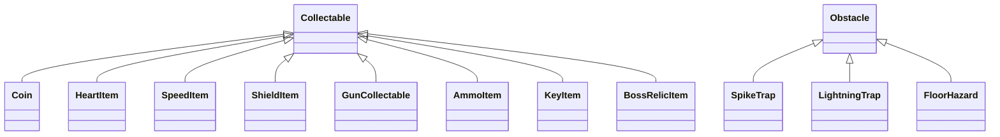

# MazeGunners



A top-down 2D action maze game in Java (libGDX). The player navigates sci-fi lab mazes, collects a key, survives enemies and traps, and reaches the exit. The project includes story mode levels, a procedural endless mode, a skill tree, a casino with run-only buffs, achievements, leaderboards, and a developer console.

Built by a team of four for the Fundamentals of Programming course at the Technical University of Munich (winter semester 2025/26).

## Team and contributions

- **Luka Petricevic** – enemy AI and combat: A* grid pathfinding, finite-state enemy behaviors (patrol, chase, idle, return to patrol) behind a common `BehaviorState` interface, the enemy types (MutantWorker, RobotGuard, FlyingDrone with laser attacks), enemy spawning, the combat system, and traps and hazards (spike, lightning and floor hazards) with their placement.
- **Anton**, **Tim Hufnagel**, **Andrew Shin** – remaining game systems (maps, UI and screens, items, progression, casino, boss).

## How to Run

Requirements: Java 17 (Gradle wrapper included).

```
./gradlew desktop:run        # macOS/Linux
./gradlew.bat desktop:run    # Windows
```

## Project Structure

Top-level folders:

```
assets/        Game assets (textures, sounds, music, UI skin)
core/          Shared game code (logic, rendering, screens)
desktop/       Desktop launcher (LWJGL3)
maps/          Local/custom .properties maps (optional)
saves/         Save file location (save.json)
```

Core code packages (`core/src/de/tum/cit/fop/maze`):

- `ai/` Pathfinding and patrol/entrance discovery utilities.
- `behavior/` Enemy AI state implementations (Patrol/Chase/Evade/Retreat/Return).
- `camera/` Camera and zoom input handling.
- `collision/` Collision handling utilities.
- `enemies/` Enemy types, boss, spawners, and enemy-specific logic.
- `gambling/` Progression and run-only casino state.
- `hud/` HUD layout, minimap container, notifications.
- `items/` Collectables and item spawner.
- `map/` Maze generation, loading/export, tiles, rooms, rendering.
- `obstacles/` Traps and obstacle audio manager.
- `player/` Player, bullets, input, stats, ammo/reload.
- `score/` Leaderboards and score entries.
- `ui/` Screens and windows (menu, settings, casino, leaderboard, etc.).
- `util/` Preferences, audio manager, achievements, story manager.
- `world/` Combat system, obstacle placement, interaction logic.

Key entry points:

- `MazeRunnerGame` (core) – global assets, preferences, screen switching.
- `DesktopLauncher` (desktop) – starts the game.
- `GameScreen` – main gameplay loop (story + endless).

## Class Hierarchy Overview

Main inheritance/relationships:

- Screens implement `com.badlogic.gdx.Screen` (MenuScreen, GameScreen, SettingsScreen, etc.).
- Enemies inherit from `Enemy` (MutantWorker, RobotGuard, FlyingDrone). The boss is its own class (`Boss`).
- Obstacles inherit from `Obstacle` (SpikeTrap, LightningTrap, FloorHazard).
- Items inherit from `Collectable` (Coin, HeartItem, SpeedItem, ShieldItem, GunCollectable, AmmoItem, KeyItem, BossRelicItem).
- Enemy AI behaviors implement `BehaviorState` (Patrol/Chase/Evade/Retreat/ReturnToPatrol).

### UML (Screens + Core Flow)



### UML (Entities)



### UML (Items + Obstacles)



## Maps and Saves

### Maps / Properties Files

- Built-in maps live in `maps/level-*.properties`.
- Custom maps can be dropped into `maps/` (local). Local files override internal ones if names match.
- The Level Select screen lists all `.properties` files from both locations.

### Save / Load

- Save file: `saves/save.json`.
- Settings (keys/audio) are stored via libGDX preferences (`maze_runner_prefs`).

## Controls (Default)

- Move: Arrow Keys
- Run/Dash: Left Shift
- Melee: Space
- Shoot: F
- Reload: R
- Toggle Map: M
- Zoom In/Out: E / Q
- Pause: Esc
- Dev Console: `~` (grave)

Keys can be remapped in Settings.

## Game Mechanics Beyond Minimum Requirements

This project includes additional mechanics and systems beyond the baseline requirements:

- **Casino (Run-only buffs):** Slots and Blackjack on a dedicated casino screen. Buffs apply only to the current run (persist across floors and save/load), then reset when starting a new run.
- **Gun + Ammo System:** Player can acquire a gun, shoot with a limited clip, and reload using ammo pickups.
- **Boss Fight:** A dedicated boss room with unique attacks and audio cues.
- **Fog of War + Exploration Minimap:** The minimap only reveals explored rooms/halls; entrance is always visible and exit appears after obtaining the key.
- **Round Scaling Notifications:** Endless mode shows per-round enemy scaling popups (HP and damage). 
- **Developer Console Commands:** In-game console for testing (e.g., give gun/key, set stats, toggle god mode, load level).
- **Multiple Enemy Types with Distinct Behaviors:** MutantWorker, RobotGuard, and FlyingDrone with different AI patterns.
- **Progression System:** Skill tree with unlockable abilities (rapid fire, shotgun, piercing, dash, ghost, thorns, repulse) and stat upgrades.

## Notes on Requirements Alignment

- The game loads any `.properties` maze via the Level Select menu and supports procedural generation for endless mode.
- Enemies use A* pathfinding plus behavior states (patrol/chase/idle/return to patrol).
- Achievements are tracked and persisted with libGDX preferences and surfaced via a dedicated screen.

If you want a more detailed UML (per-package or per-feature), add more diagrams and classes here.